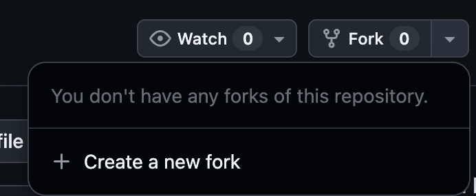

# 1. Fork this repo

1. On this GitHub repo, look for the Fork button on the upper right. 



2. Click `create a new fork` and follow the instructions. 


# 2. Clone this fork to make your own repo

On this repo page is a `code` button. Click it and copy the url. 

In your local terminal, make a new directory and enter it. You can name the directory whatever you want, but make it clear and findable. 

```sh
ls
cd python-projects
mkdir github-first-repo
cd github-first-repo
git clone repo-path.git
code .
```

<!-- insert image -->


# 2. In your local application, find and fix the errors in `analysis.py`.

1. Fix the paths and information that is left blank in the `#TODO` section.

2. Read the code and find the syntax and spelling errors in the code. 

If it runs but doesn't print anything, that's a bug too. 

3. After the app runs successfully, commit and push your changes to your repo. 

```sh
git add analysis.py
git commit -m "Fix errors in analysis.py"
git push origin branch
```

4. Look at your changes on your repo. 
